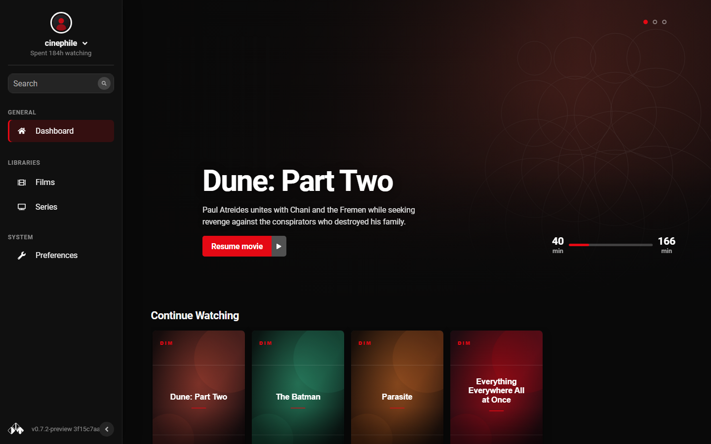

# Dim Enhanced — tema Netflix para Dim, build para ZimaOS

Fork de [Dim](https://github.com/Dusk-Labs/dim) con un rediseño visual inspirado en
Netflix aplicado a **toda la interfaz web**. El resto se mantiene igual: mismas rutas,
API, escaneo de biblioteca, autenticación y reproductor.

Repo: **https://github.com/marcodido69/dim-enhanced**
Imagen: **ghcr.io/marcodido69/dim-enhanced:latest**



## Interfaz

El tema cubre todas las pantallas, no solo el dashboard:

| Pantalla | Correctamente tematizada |
| --- | --- |
| Login / registro | panel centrado, acento rojo, inputs con foco |
| Dashboard | banner grande, carruseles horizontales de posters |
| Bibliotecas | grilla responsive de posters 2:3, hover, menú de acciones |
| Detalle de media | poster + ficha, tarjetas de metadata, temporadas en carrusel, episodios 16:9 |
| Búsqueda | grilla de resultados con el mismo estilo de cards |
| Preferencias | navegación con indicador rojo, cards de sección, toggles e inputs |
| Modales / dropdowns / hovercards | superficies oscuras, bordes y acentos consistentes |
| Reproductor | seekbar fina roja, controles y menús con fondo difuminado |

Más capturas en `docs/design/enhanced/`.

## Qué cambió en este fork

- `ui/src/Enhanced.scss`: tema oscuro/cinematográfico (fondo `#090909`, acento `#e50914`,
  superficies `#141414`–`#242424`), variables de color y carrusel de posters.
- `ui/src/EnhancedPages.scss` (**nuevo**): extiende el tema a auth, bibliotecas, media,
  búsqueda, preferencias, modales, dropdowns, hovercards y reproductor, con responsive.
- `ui/src/App.jsx`: importa la hoja de estilos nueva (único cambio de JSX).
- **Mejoras de UX** (posteriores al primer deploy):
  - `Components/Sidebar/Libraries.jsx`: la sección **Libraries** y el botón `+` se
    muestran siempre, incluso con 0 bibliotecas (antes desaparecían y no había forma
    de crear la primera biblioteca desde el sidebar).
  - `Pages/Preferences/Invites/ManageInvites.jsx` + `actions/auth.js`: el botón de
    generar invitación solo aparece para cuentas `owner` y, si el backend responde
    401, ahora se muestra un aviso en lugar de fallar en silencio.
  - `EnhancedPages.scss`: estilos para el `+` siempre visible, el estado "No
    libraries yet" y el aviso de permisos.
- `Dockerfile` **corregido para que vuelva a compilar**:
  - Debian 11 (bullseye) está EOL y sus paquetes apt ya no existen → imágenes base
    migradas a **Debian 12 (bookworm)**.
  - Stage de UI con **Node 22** (en lugar de 18) y `HUSKY=0`.
  - Stage de Rust con el toolchain **stable actual**; se elimina `rust-toolchain.toml`
    dentro de la imagen y se define `CARGO_TARGET_DIR` (lo leen los `build.rs`).
  - Se agrega `libsqlite3-dev` y `pkg-config` a las dependencias del build.
- `.github/workflows/dim-enhanced.yml`: construye y publica la imagen en GHCR en cada
  push a `main` (linux/amd64, cache de Buildx, cancela builds viejos, intenta dejar el
  paquete público). Los workflows heredados de Rust/React/docs quedan solo manuales.
- `docker-compose-zimaos.yml`: compose listo para el equipo ZimaOS.

## Cómo se publica la imagen

1. Hacé push a `main` en https://github.com/marcodido69/dim-enhanced (o corré el
   workflow **Build and publish Dim Enhanced** a mano desde la pestaña Actions).
2. Esperá a que termine el job `docker`. La primera vez tarda ~20–40 minutos porque
   compila la UI y el backend Rust dentro de la imagen; las siguientes corridas
   reutilizan la cache de Docker.
3. La imagen publicada es `ghcr.io/marcodido69/dim-enhanced:latest` (y también
   `:commit-sha`).
4. El workflow intenta dejar el paquete público automáticamente. Si no lo logra,
   entrá al paquete en GitHub → **Package settings** → **Change visibility** →
   **Public**. Es necesario para que ZimaOS pueda hacer `docker pull` sin login.

Notas:

- La imagen es **linux/amd64** (ZimaOS corre en x86). Para sumar arm64, agregá
  `linux/amd64,linux/arm64` en `platforms:` del workflow, sabiendo que el build tarda
  mucho más por la emulación.
- No se publican binarios sueltos: solo la imagen.
- El tema fuerza siempre la paleta oscura; los temas Light/Blind de Preferencias no
  cambian el aspecto (comportamiento intencional de este fork).

## Desplegar en ZimaOS

1. Copiá `docker-compose-zimaos.yml` al equipo (por ejemplo a
   `/DATA/AppData/dim-enhanced/docker-compose.yml`).
2. Revisá las rutas montadas:
   - Config: `/DATA/AppData/dim-enhanced/config` → `/opt/dim/config`
   - Películas: `/media/1TBWD_1/Media/Movies` → `/media/movies` (solo lectura)
   - Web: puerto `8000`
3. Si tu ruta de medios es otra, cambiala en el compose.
4. Levantá el contenedor:
   ```bash
   docker compose -f docker-compose-zimaos.yml up -d
   ```
5. Entrá a `http://IP-DEL-ZIMAOS:8000`, creá la biblioteca de películas y usá
   `/media/movies` como ruta dentro del contenedor.

Si ZimaOS no tiene `/dev/dri` o la aceleración falla, quitá el bloque `devices:` y
volvé a levantar el contenedor.

## Roles: owner vs user (invitaciones y bibliotecas)

Solo las cuentas con rol **owner** pueden generar invitaciones y crear bibliotecas,
y únicamente el **primer usuario registrado** en una base de datos recibe ese rol.
Quien entra con una invitación queda como `user`.

Síntomas si tu cuenta no es `owner`:

- "Generate a new token" no hace nada (la API responde **401**).
- No aparece el `+` de *Libraries* ni el botón "Add library" del Dashboard.

La base de datos vive en el volumen de configuración
(`/DATA/AppData/dim-enhanced/config/dim.db`). Para revisar los roles, con el
contenedor detenido:

```bash
docker compose -f docker-compose-zimaos.yml stop
cp /DATA/AppData/dim-enhanced/config/dim.db /DATA/AppData/dim-enhanced/config/dim.db.bak
docker run --rm -v /DATA/AppData/dim-enhanced/config:/config alpine:3 sh -c \
  'apk add -q sqlite && sqlite3 /config/dim.db "select id,username,roles from users;"'
docker compose -f docker-compose-zimaos.yml start
```

Los roles se guardan como JSON (`["owner"]` / `["user"]`). Para promover una cuenta,
con el contenedor detenido y backup previo, abrí `config/dim.db` con cualquier cliente
SQLite y ejecutá:

```sql
UPDATE users SET roles = '["owner"]' WHERE username = 'marco';
```

Después arrancá el contenedor de nuevo. Si la instancia está vacía (sin bibliotecas
ni progreso), la opción más limpia es respaldar y borrar `config/dim.db*` y volver a
registrar la primera cuenta, que será `owner`.

## Importante

- Conservá tu contenedor y configuración actuales de Dim hasta probar esta imagen.
- El proyecto está bajo licencia AGPL-3.0 (`LICENSE.md`). Si distribuís la imagen, el
  código fuente de estas modificaciones queda disponible en este mismo repo.
